# Sofle ZMK Config

ZMK configuration for a Sofle split keyboard on `nice_nano_v2`.

## Keymap Preview

This preview is generated from [`config/sofle.keymap`](config/sofle.keymap) and committed to [`keymap-drawer/sofle.svg`](keymap-drawer/sofle.svg).



## Build and flash

Needs Nix with flakes and `just`; everything else comes from `flake.nix`.

```sh
just flash left        # incremental local build, then flash
just flash right
just flash left ci     # flash the latest green CI build of the current branch instead
just build left        # build only, prints the .uf2 path
just nix-build         # clean reproducible build of both halves into ./result
just update            # bump west.yml revisions and zephyrDepsHash
```

Both halves expose a USB serial port named `Sofle`
(`snippets/bootloader-on-1200-baud`). Setting it to 1200 baud reboots the half into
the UF2 bootloader, so `just flash` needs no `&bootloader` key or reset double-tap.
The first flash of a half without this firmware still needs `&bootloader`.

Plug in only the half being flashed.

`west.yml` revisions are pinned to commits because `zephyrDepsHash` covers the
fetched sources; run `just update` instead of editing them by hand.
